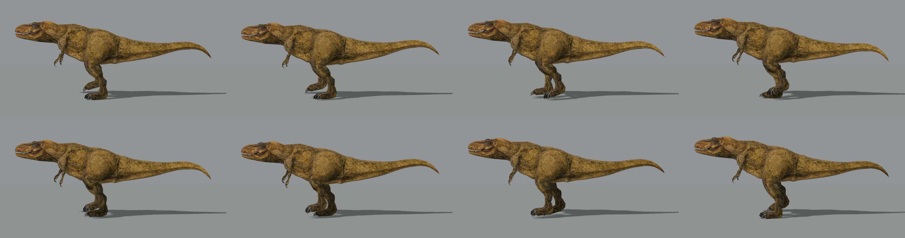

# PS1 Developer's Demo T-Rex — editable Blender rig + reconstructed walk

This repository takes the dinosaur model from the *PlayStation Developer's Demo
CD* (Models — Dino) and builds, entirely headless (no GUI clicking), a fully
editable Blender rig and a reconstructed walk-in-place animation:

- **1:1 source**: the original `dino.obj` (2332 vertices / 2724 triangles),
  its UVs, its material list and the six VRAM-page PNGs are used untouched.
  No retopology, no texture edits, no re-exported geometry.
- **Editable rig**: a real armature (`TREX_EDITABLE_ARMATURE`, 28 bones,
  27 deform) with vertex groups and normalized 4-influence weights.
- **Walk cycle**: a 40-frame / 30 fps in-place loop (`Walk`, 1.33 s) solved
  with analytic 2-link IK so the claw tips follow an editable foot-target
  table. Feet plant flat, sweep back during stance and clear the ground
  during swing.

The original animation data does not exist in the OBJ, so the walk is a
faithful **reconstruction** on the true model, not a byte-exact port of the
demo's clip. See [NOTICE.md](NOTICE.md) for asset attribution.



## Requirements

- [Blender](https://www.blender.org/) 5.x (tested: 5.2.2 LTS)
  - macOS: `brew install --cask blender`
  - or any install; point `BLENDER_BIN` at the binary, or have `blender`
    on `PATH`
- Python 3 for the preflight test and the GLB verifier (standard library only)

## Quick start

```bash
./run_all.sh
```

That runs four steps: preflight test (no Blender) → build rig → animate walk,
export GLB, render preview → verify GLB. Everything is regenerated from
`source/dino/dino.obj`; nothing in `output/` is hand-edited.

Then open the scene:

```bash
open output/trex_editable.blend    # select the armature, Pose Mode, Space to play
```

## Desktop viewer (mesh + rig)

A reusable viewer tool ships with the repository. It opens a real Blender
window configured as a model viewer: the GLB is imported fresh (confirming the
file is self-contained), the skeleton is drawn in front of the mesh in stick
style, and the Walk cycle plays on a loop.

```bash
python3 viewer.py            # view output/trex_blender_rig.glb
python3 viewer.py --blend    # view output/trex_editable.blend instead
python3 viewer.py --check    # headless validation, no window
```

The launcher works on macOS, Linux and Windows: it finds Blender via
`BLENDER_BIN`, then `blender` on `PATH`, then the standard install locations
for the OS.

Inside the window:

- `Space` plays/pauses; mouse buttons orbit/pan/zoom as usual
- press `N` for the **T-Rex Viewer** sidebar tab: mesh / skeleton visibility,
  wireframe overlay, shading mode (Solid / Material Preview / Rendered /
  Wireframe), Play-Pause and Reset View buttons
- `Solid` shading is the rig-inspection mode: the bones read clearly over the
  mesh silhouette

## Outputs

| File | What it is |
|---|---|
| `output/trex_editable.blend` | Mesh + packed textures, armature, vertex groups, `Walk` action, frames 0–40 @ 30 fps |
| `output/trex_blender_rig.glb` | Binary glTF: 1 skin (28 joints), 7 primitives, 6 packed textures, `Walk` clip (1.33 s, loops in place) |
| `diagnostics/rig/` | Test-pose renders (knee/hock/ankle/head/tail/arm extremes) |
| `diagnostics/walk/` | Walk contact sheet, 3/4 still and front still |

## The pipeline

| Script | Role |
|---|---|
| `rig_trex_blender.py` | Parses the OBJ, builds mesh + materials (point-sampled textures), armature from the editable `JOINTS` table, and envelope weights. `--clean-scene` removes Blender's factory Cube/Light/Camera |
| `animate_trex.py` | Builds the `Walk` action: `FOOT_TARGETS` table + analytic thigh/shin IK + parametric body/tail/head/arm layers. Saves the blend, exports the GLB, renders the contact sheet |
| `diagnose_rig.py` | Headless rig diagnostics: bone axis table and signed test-pose renders into `diagnostics/rig/` |
| `check_walk.py` | Numeric walk trace: claw-tip height per key frame, ground-penetration check |
| `verify_glb.py` | Parses the GLB's JSON chunk: skin, joints, textures, animation name/duration |
| `test_rig_math.py` | No-Blender preflight: source integrity, weight normalization per vertex, foot-target table sanity |
| `run_all.sh` / `run_mac.sh` | One-shot full pipeline / rig-only pass |

## Tuning the walk

Open `animate_trex.py`. The knobs, in order of usefulness:

1. **`FOOT_TARGETS`** — one row per 1/8 cycle for one leg (the other leg is
   offset half a cycle). Each row is `(claw tip y, claw tip z, heel-rise deg)`:
   forward is negative `y`, ground contact is around `z = 0.035`, positive
   heel-rise rolls the foot over the claws (toe-off), negative dips the claws
   (touchdown). Keep the first and last rows identical for a seamless loop.
2. `BOB`, `PELVIS_YAW`, `PELVIS_ROLL`, `SPINE_PITCH` — body motion.
3. `TAIL_YAW`, `TAIL_LAG`, `HEAD_*`, `ARM_*` — secondary layers.
4. `CYCLE` / `FPS` — cycle length and speed.

Then:

```bash
"$(command -v blender || echo /Applications/Blender.app/Contents/MacOS/Blender)" \
  -b --factory-startup --python animate_trex.py -- --export-glb --preview
python3 verify_glb.py
```

## Editing in Blender (GUI)

1. Select `TREX_EDITABLE_ARMATURE` in the Outliner. Numpad 3 for the right
   side view, Numpad 5 to toggle orthographic.
2. **Edit Mode** (`Tab`): move bone heads/tails. Leg chain: `Thigh` →
   `Shin` → `Tarsus` → `Foot` → `Toes`. The knee sits forward, the hock
   backward, the ankle low. The same points live in `JOINTS` in
   `rig_trex_blender.py`; change them there and rerun, or move them in the
   GUI and re-solve the walk afterwards.
3. **Pose Mode**: play the `Walk` action (`Space`). Every frame is a plain
   FK keyframe — no constraints, nothing hidden — so it is safe to edit.
4. **Weight Paint** (`Thigh.L/.R` etc.): the scripted weights are a good
   starting envelope; hand-painting improves extreme poses. The untextured
   `Untextured_faces` material faces are the mouth interior.
5. `Jaw` exists but is deliberately unweighted: the OBJ has no separate
   lower-jaw topology, so animating it would tear the muzzle. Split the
   geometry first if you want a biting dino.

## Verification

```bash
python3 test_rig_math.py          # source + weights + foot table, no Blender
./run_all.sh                      # full regeneration + GLB verification
"${BLENDER_BIN:-/Applications/Blender.app/Contents/MacOS/Blender}" \
  -b --factory-startup --python check_walk.py        # numeric walk trace
"${BLENDER_BIN:-/Applications/Blender.app/Contents/MacOS/Blender}" \
  -b --factory-startup --python diagnose_rig.py -- --no-render
```

`check_walk.py` is the ground truth for the gait: it prints the claw-tip
position per key frame and flags any below-ground penetration.

## Known limits

- The walk is a reconstruction (see above); stride, bob and tail action are
  taste parameters.
- Weights are scripted envelopes: clean at all tested joint extremes, but a
  manual Weight Paint pass is the recommended final polish.
- The jaw does not animate, by design (no separate jaw topology in the OBJ).
- Materials use `Closest` texture interpolation to preserve the PS1 pixel
  look; other renderers may show different filtering.

## Troubleshooting

- **macOS kills Blender after a Homebrew install** (app disappears, exit
  code 137). macOS 27 treats the quarantined copy as untrusted. Fix:

  ```bash
  xattr -dr com.apple.quarantine /Applications/Blender.app
  ```

- **`hdiutil: attach failed - resource busy`** during `brew install --cask
  blender`: another mount of the same DMG is still attached. Eject it
  (`hdiutil detach /Volumes/Blender`) and reinstall.
- **A white cube in the scene/renders**: Blender's factory-startup Cube.
  Use `--clean-scene` (both runners already do).
- **Blender 5.x API changes** (`Action.fcurves` is now slotted): handled by
  `iter_fcurves()` in `animate_trex.py` and fallbacks in
  `rig_trex_blender.py`.

## Repository layout

```
source/dino/           original OBJ, MTL and the six VRAM-page PNGs (untouched)
rig_trex_blender.py    OBJ -> mesh + armature + weights
animate_trex.py        Walk action (IK foot targets + body layers) + export
diagnose_rig.py        pivot/axis diagnostics and signed test renders
check_walk.py          numeric foot-contact trace
verify_glb.py          GLB structure/animation verifier
test_rig_math.py       no-Blender preflight assertions
run_all.sh             one-command pipeline
run_mac.sh             rig-only convenience script
viewer.py              cross-platform desktop viewer launcher (macOS/Windows/Linux)
trex_viewer.py         in-Blender viewer: mesh + skeleton + Walk playback
lib_trex.py            shared helpers (world-axis pose math, cameras)
output/                generated blend + GLB (committed for convenience)
diagnostics/           generated render evidence
```

## Credits and license

The dinosaur model, its textures and the demo it comes from are
© Sony Computer Entertainment / Sony Interactive Entertainment; they are
included for preservation and educational purposes only — see
[NOTICE.md](NOTICE.md), including the takedown policy.

All tooling in this repository (the scripts, the reconstructed animation and
the generated files) is original work, released under the [MIT
License](LICENSE).
